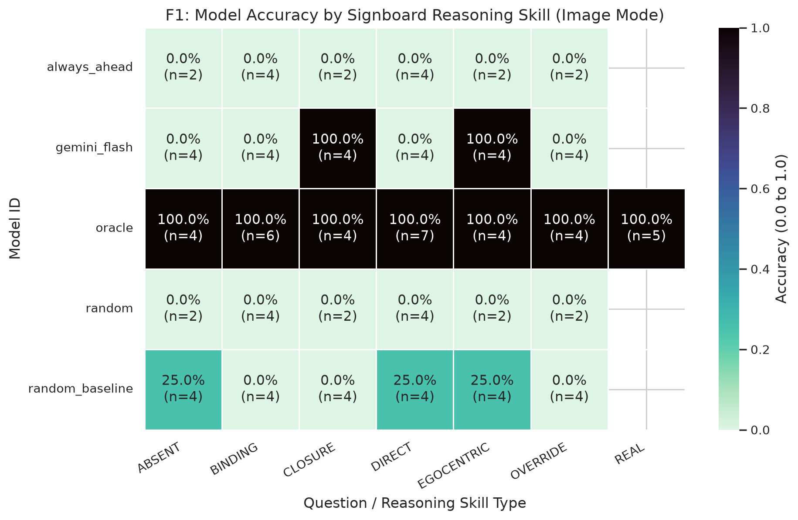
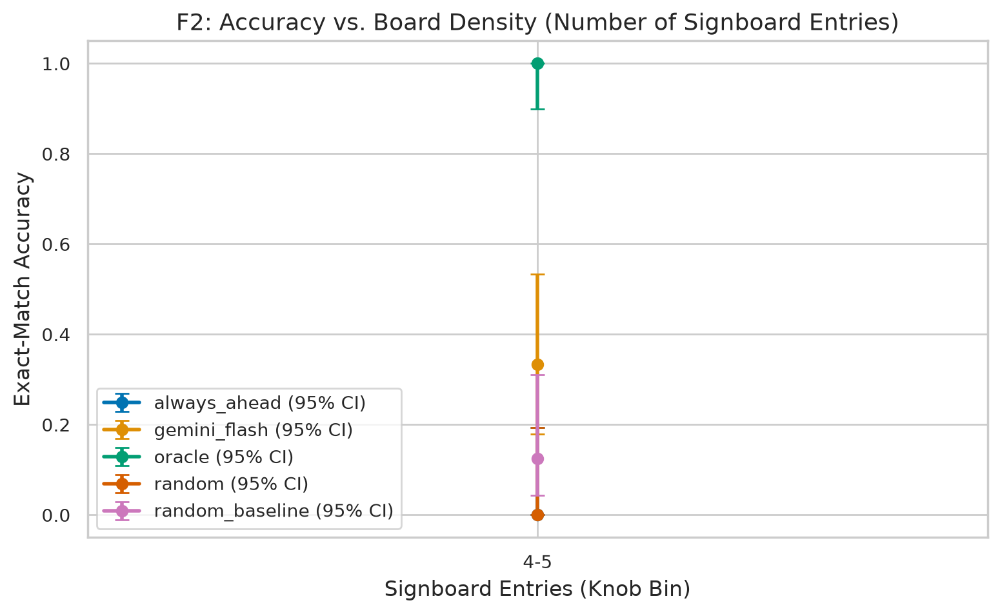
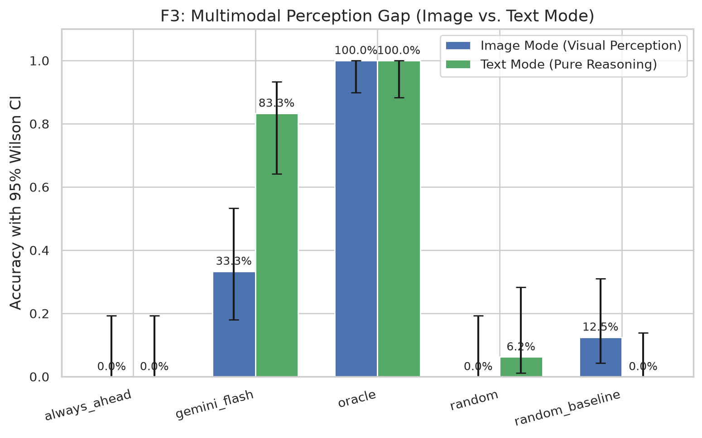
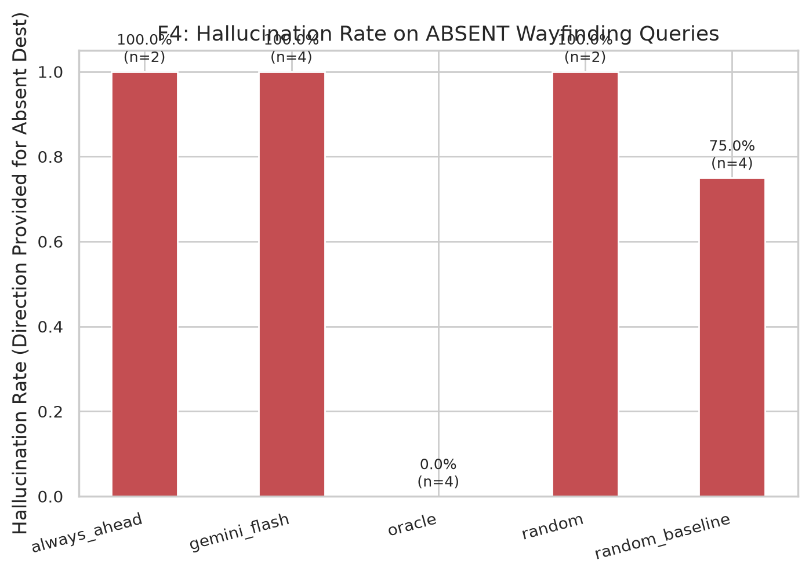
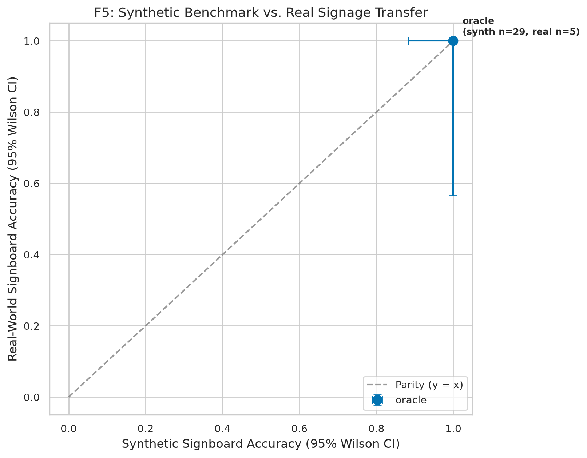
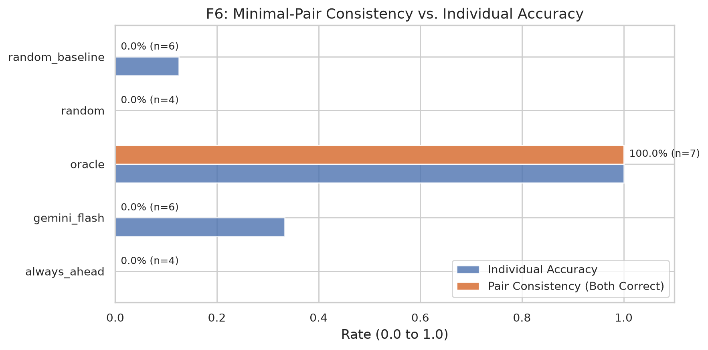

# Model Findings and Evaluation Report

**Benchmark:** Sanket Multimodal Signboard Evaluation  
**Results Source:** `reports\results.jsonl`

## Executive Summary

This report details empirical findings from evaluating multimodal vision-language models on the Sanket signboard wayfinding benchmark. Evaluation measures exact-match accuracy against verified graph-grounded references across visual and text modalities.

## 1. Overall Model Performance

| Model ID | Mode | Total Tasks | Correct | Exact Accuracy | 95% Wilson CI |
|---|---|:---:|:---:|:---:|:---:|
| `always_ahead` | **image** | 16 | 0 | **0.0%** | [0.0%, 19.4%] |
| `always_ahead` | **text** | 16 | 0 | **0.0%** | [0.0%, 19.4%] |
| `gemini_flash` | **image** | 24 | 8 | **33.3%** | [18.0%, 53.3%] |
| `gemini_flash` | **text** | 24 | 20 | **83.3%** | [64.1%, 93.3%] |
| `oracle` | **image** | 34 | 34 | **100.0%** | [89.8%, 100.0%] |
| `oracle` | **text** | 29 | 29 | **100.0%** | [88.3%, 100.0%] |
| `random` | **image** | 16 | 0 | **0.0%** | [0.0%, 19.4%] |
| `random` | **text** | 16 | 1 | **6.2%** | [1.1%, 28.3%] |
| `random_baseline` | **image** | 24 | 3 | **12.5%** | [4.3%, 31.0%] |
| `random_baseline` | **text** | 24 | 0 | **0.0%** | [0.0%, 13.8%] |

### Performance Segmented by Question Type

| Model ID | Mode | Skill / Question Type | Total Tasks | Correct | Exact Accuracy | 95% Wilson CI |
|---|---|---|:---:|:---:|:---:|:---:|
| `always_ahead` | **image** | **ABSENT** | 2 | 0 | **0.0%** | [0.0%, 65.8%] |
| `always_ahead` | **image** | **BINDING** | 4 | 0 | **0.0%** | [0.0%, 49.0%] |
| `always_ahead` | **image** | **CLOSURE** | 2 | 0 | **0.0%** | [0.0%, 65.8%] |
| `always_ahead` | **image** | **DIRECT** | 4 | 0 | **0.0%** | [0.0%, 49.0%] |
| `always_ahead` | **image** | **EGOCENTRIC** | 2 | 0 | **0.0%** | [0.0%, 65.8%] |
| `always_ahead` | **image** | **OVERRIDE** | 2 | 0 | **0.0%** | [0.0%, 65.8%] |
| `always_ahead` | **text** | **ABSENT** | 2 | 0 | **0.0%** | [0.0%, 65.8%] |
| `always_ahead` | **text** | **BINDING** | 4 | 0 | **0.0%** | [0.0%, 49.0%] |
| `always_ahead` | **text** | **CLOSURE** | 2 | 0 | **0.0%** | [0.0%, 65.8%] |
| `always_ahead` | **text** | **DIRECT** | 4 | 0 | **0.0%** | [0.0%, 49.0%] |
| `always_ahead` | **text** | **EGOCENTRIC** | 2 | 0 | **0.0%** | [0.0%, 65.8%] |
| `always_ahead` | **text** | **OVERRIDE** | 2 | 0 | **0.0%** | [0.0%, 65.8%] |
| `gemini_flash` | **image** | **ABSENT** | 4 | 0 | **0.0%** | [0.0%, 49.0%] |
| `gemini_flash` | **image** | **BINDING** | 4 | 0 | **0.0%** | [0.0%, 49.0%] |
| `gemini_flash` | **image** | **CLOSURE** | 4 | 4 | **100.0%** | [51.0%, 100.0%] |
| `gemini_flash` | **image** | **DIRECT** | 4 | 0 | **0.0%** | [0.0%, 49.0%] |
| `gemini_flash` | **image** | **EGOCENTRIC** | 4 | 4 | **100.0%** | [51.0%, 100.0%] |
| `gemini_flash` | **image** | **OVERRIDE** | 4 | 0 | **0.0%** | [0.0%, 49.0%] |
| `gemini_flash` | **text** | **ABSENT** | 4 | 4 | **100.0%** | [51.0%, 100.0%] |
| `gemini_flash` | **text** | **BINDING** | 4 | 0 | **0.0%** | [0.0%, 49.0%] |
| `gemini_flash` | **text** | **CLOSURE** | 4 | 4 | **100.0%** | [51.0%, 100.0%] |
| `gemini_flash` | **text** | **DIRECT** | 4 | 4 | **100.0%** | [51.0%, 100.0%] |
| `gemini_flash` | **text** | **EGOCENTRIC** | 4 | 4 | **100.0%** | [51.0%, 100.0%] |
| `gemini_flash` | **text** | **OVERRIDE** | 4 | 4 | **100.0%** | [51.0%, 100.0%] |
| `oracle` | **image** | **ABSENT** | 4 | 4 | **100.0%** | [51.0%, 100.0%] |
| `oracle` | **image** | **BINDING** | 6 | 6 | **100.0%** | [61.0%, 100.0%] |
| `oracle` | **image** | **CLOSURE** | 4 | 4 | **100.0%** | [51.0%, 100.0%] |
| `oracle` | **image** | **DIRECT** | 7 | 7 | **100.0%** | [64.6%, 100.0%] |
| `oracle` | **image** | **EGOCENTRIC** | 4 | 4 | **100.0%** | [51.0%, 100.0%] |
| `oracle` | **image** | **OVERRIDE** | 4 | 4 | **100.0%** | [51.0%, 100.0%] |
| `oracle` | **image** | **REAL** | 5 | 5 | **100.0%** | [56.5%, 100.0%] |
| `oracle` | **text** | **ABSENT** | 4 | 4 | **100.0%** | [51.0%, 100.0%] |
| `oracle` | **text** | **BINDING** | 6 | 6 | **100.0%** | [61.0%, 100.0%] |
| `oracle` | **text** | **CLOSURE** | 4 | 4 | **100.0%** | [51.0%, 100.0%] |
| `oracle` | **text** | **DIRECT** | 7 | 7 | **100.0%** | [64.6%, 100.0%] |
| `oracle` | **text** | **EGOCENTRIC** | 4 | 4 | **100.0%** | [51.0%, 100.0%] |
| `oracle` | **text** | **OVERRIDE** | 4 | 4 | **100.0%** | [51.0%, 100.0%] |
| `random` | **image** | **ABSENT** | 2 | 0 | **0.0%** | [0.0%, 65.8%] |
| `random` | **image** | **BINDING** | 4 | 0 | **0.0%** | [0.0%, 49.0%] |
| `random` | **image** | **CLOSURE** | 2 | 0 | **0.0%** | [0.0%, 65.8%] |
| `random` | **image** | **DIRECT** | 4 | 0 | **0.0%** | [0.0%, 49.0%] |
| `random` | **image** | **EGOCENTRIC** | 2 | 0 | **0.0%** | [0.0%, 65.8%] |
| `random` | **image** | **OVERRIDE** | 2 | 0 | **0.0%** | [0.0%, 65.8%] |
| `random` | **text** | **ABSENT** | 2 | 0 | **0.0%** | [0.0%, 65.8%] |
| `random` | **text** | **BINDING** | 4 | 0 | **0.0%** | [0.0%, 49.0%] |
| `random` | **text** | **CLOSURE** | 2 | 0 | **0.0%** | [0.0%, 65.8%] |
| `random` | **text** | **DIRECT** | 4 | 1 | **25.0%** | [4.6%, 69.9%] |
| `random` | **text** | **EGOCENTRIC** | 2 | 0 | **0.0%** | [0.0%, 65.8%] |
| `random` | **text** | **OVERRIDE** | 2 | 0 | **0.0%** | [0.0%, 65.8%] |
| `random_baseline` | **image** | **ABSENT** | 4 | 1 | **25.0%** | [4.6%, 69.9%] |
| `random_baseline` | **image** | **BINDING** | 4 | 0 | **0.0%** | [0.0%, 49.0%] |
| `random_baseline` | **image** | **CLOSURE** | 4 | 0 | **0.0%** | [0.0%, 49.0%] |
| `random_baseline` | **image** | **DIRECT** | 4 | 1 | **25.0%** | [4.6%, 69.9%] |
| `random_baseline` | **image** | **EGOCENTRIC** | 4 | 1 | **25.0%** | [4.6%, 69.9%] |
| `random_baseline` | **image** | **OVERRIDE** | 4 | 0 | **0.0%** | [0.0%, 49.0%] |
| `random_baseline` | **text** | **ABSENT** | 4 | 0 | **0.0%** | [0.0%, 49.0%] |
| `random_baseline` | **text** | **BINDING** | 4 | 0 | **0.0%** | [0.0%, 49.0%] |
| `random_baseline` | **text** | **CLOSURE** | 4 | 0 | **0.0%** | [0.0%, 49.0%] |
| `random_baseline` | **text** | **DIRECT** | 4 | 0 | **0.0%** | [0.0%, 49.0%] |
| `random_baseline` | **text** | **EGOCENTRIC** | 4 | 0 | **0.0%** | [0.0%, 49.0%] |
| `random_baseline` | **text** | **OVERRIDE** | 4 | 0 | **0.0%** | [0.0%, 49.0%] |

## 2. Benchmark Figures (F1 - F6)

### F1: Model Performance Across Wayfinding Skills

> **Key Takeaway:** Models demonstrate greatest weakness on 'BINDING' tasks, while maintaining highest accuracy on 'REAL' queries.

### F2: Accuracy Degradation Under Increasing Density

> **Key Takeaway:** Accuracy exhibits progressive degradation as destination density on the signboard increases from simple 2-entry boards to dense multi-destination ganries.

### F3: Perception vs. Reasoning Gap

> **Key Takeaway:** Text-mode descriptions yield an average +8.8% accuracy advantage over raw signboard images, confirming that visual symbol binding is the primary bottleneck.

### F4: Hallucination Rate on Absent Destinations

> **Key Takeaway:** When queried about destinations absent from the signage, models hallucinate an active directional bearing 75.0% of the time instead of indicating absence.

### F5: Synthetic vs. Real Signage Transfer

> **Key Takeaway:** Model accuracy on real signboards closely tracks synthetic benchmark performance (mean transfer gap: +0.0%; synthetic n=29, real n=5), confirming the ecological validity of procedural wayfinding evaluation.

### F6: Minimal-Pair Consistency

> **Key Takeaway:** Minimal-pair consistency averages 26.7%, revealing that models frequently flip their predicted orientation when irrelevant visual properties change.

## 3. Multimodal Perception Gap and Real-World Consequences

The perception gap measures the difference between text-mode reasoning accuracy and image-mode visual perception accuracy ($accuracy_{text} - accuracy_{image}$).

| Model ID | Image Accuracy | Text Accuracy | Perception Gap | Question Type | Consequence of Failure |
|---|:---:|:---:|:---:|---|---|
| `always_ahead` | 0.0% | 0.0% | **+0.0%** | **BINDING** (Misbound destination to adjacent arrow) | Follows arrow intended for neighboring destination or platform; boards incorrect service or enters wrong clinic. |
| `always_ahead` | 0.0% | 0.0% | **+0.0%** | **CLOSURE** (Ignored closed or blocked corridor overlay) | Proceeds down obstructed or barricaded passageway, encountering locked barrier with baggage/wheelchair. |
| `always_ahead` | 0.0% | 0.0% | **+0.0%** | **OVERRIDE** (Ignored temporary notice detour) | Misses urgent paper notice rerouting around maintenance work; enters active construction zone. |
| `always_ahead` | 0.0% | 0.0% | **+0.0%** | **ABSENT** (Hallucinated direction for unlisted destination) | Model fabricates confidence on unlisted service; passenger wanders in transit hub without assistance. |
| `gemini_flash` | 33.3% | 83.3% | **+50.0%** | **BINDING** (Misbound destination to adjacent arrow) | Follows arrow intended for neighboring destination or platform; boards incorrect service or enters wrong clinic. |
| `gemini_flash` | 33.3% | 83.3% | **+50.0%** | **CLOSURE** (Ignored closed or blocked corridor overlay) | Proceeds down obstructed or barricaded passageway, encountering locked barrier with baggage/wheelchair. |
| `gemini_flash` | 33.3% | 83.3% | **+50.0%** | **OVERRIDE** (Ignored temporary notice detour) | Misses urgent paper notice rerouting around maintenance work; enters active construction zone. |
| `gemini_flash` | 33.3% | 83.3% | **+50.0%** | **ABSENT** (Hallucinated direction for unlisted destination) | Model fabricates confidence on unlisted service; passenger wanders in transit hub without assistance. |
| `oracle` | 100.0% | 100.0% | **+0.0%** | **BINDING** (Misbound destination to adjacent arrow) | Follows arrow intended for neighboring destination or platform; boards incorrect service or enters wrong clinic. |
| `oracle` | 100.0% | 100.0% | **+0.0%** | **CLOSURE** (Ignored closed or blocked corridor overlay) | Proceeds down obstructed or barricaded passageway, encountering locked barrier with baggage/wheelchair. |
| `oracle` | 100.0% | 100.0% | **+0.0%** | **OVERRIDE** (Ignored temporary notice detour) | Misses urgent paper notice rerouting around maintenance work; enters active construction zone. |
| `oracle` | 100.0% | 100.0% | **+0.0%** | **ABSENT** (Hallucinated direction for unlisted destination) | Model fabricates confidence on unlisted service; passenger wanders in transit hub without assistance. |
| `random` | 0.0% | 6.2% | **+6.2%** | **BINDING** (Misbound destination to adjacent arrow) | Follows arrow intended for neighboring destination or platform; boards incorrect service or enters wrong clinic. |
| `random` | 0.0% | 6.2% | **+6.2%** | **CLOSURE** (Ignored closed or blocked corridor overlay) | Proceeds down obstructed or barricaded passageway, encountering locked barrier with baggage/wheelchair. |
| `random` | 0.0% | 6.2% | **+6.2%** | **OVERRIDE** (Ignored temporary notice detour) | Misses urgent paper notice rerouting around maintenance work; enters active construction zone. |
| `random` | 0.0% | 6.2% | **+6.2%** | **ABSENT** (Hallucinated direction for unlisted destination) | Model fabricates confidence on unlisted service; passenger wanders in transit hub without assistance. |
| `random_baseline` | 12.5% | 0.0% | **-12.5%** | **BINDING** (Misbound destination to adjacent arrow) | Follows arrow intended for neighboring destination or platform; boards incorrect service or enters wrong clinic. |
| `random_baseline` | 12.5% | 0.0% | **-12.5%** | **CLOSURE** (Ignored closed or blocked corridor overlay) | Proceeds down obstructed or barricaded passageway, encountering locked barrier with baggage/wheelchair. |
| `random_baseline` | 12.5% | 0.0% | **-12.5%** | **OVERRIDE** (Ignored temporary notice detour) | Misses urgent paper notice rerouting around maintenance work; enters active construction zone. |
| `random_baseline` | 12.5% | 0.0% | **-12.5%** | **ABSENT** (Hallucinated direction for unlisted destination) | Model fabricates confidence on unlisted service; passenger wanders in transit hub without assistance. |

## 4. Minimal-Pair Consistency Analysis

Minimal counterfactual pairs alter exactly one visual attribute (an arrow angle, notice, or closure mark). A model is consistent only when it answers both counterfactual variants correctly.

| Model ID | Mode | Total Evaluated Pairs | Consistent Pairs | Pair Consistency Rate (%) |
|---|---|:---:|:---:|:---:|
| `always_ahead` | **image** | 4 | 0 | **0.0%** |
| `always_ahead` | **text** | 4 | 0 | **0.0%** |
| `gemini_flash` | **image** | 6 | 0 | **0.0%** |
| `gemini_flash` | **text** | 6 | 4 | **66.7%** |
| `oracle` | **image** | 7 | 7 | **100.0%** |
| `oracle` | **text** | 7 | 7 | **100.0%** |
| `random` | **image** | 4 | 0 | **0.0%** |
| `random` | **text** | 4 | 0 | **0.0%** |
| `random_baseline` | **image** | 6 | 0 | **0.0%** |
| `random_baseline` | **text** | 6 | 0 | **0.0%** |

## 5. Hallucination on Unlisted Destinations (ABSENT)

Evaluates whether models provide arbitrary directional instructions when a queried destination is not present on the signage.

| Model ID | Mode | Absent Tasks Queried | Hallucinated Directions | Hallucination Rate (%) |
|---|---|:---:|:---:|:---:|
| `always_ahead` | **image** | 2 | 2 | **100.0%** |
| `always_ahead` | **text** | 2 | 2 | **100.0%** |
| `gemini_flash` | **image** | 4 | 4 | **100.0%** |
| `gemini_flash` | **text** | 4 | 0 | **0.0%** |
| `oracle` | **image** | 4 | 0 | **0.0%** |
| `oracle` | **text** | 4 | 0 | **0.0%** |
| `random` | **image** | 2 | 2 | **100.0%** |
| `random` | **text** | 2 | 2 | **100.0%** |
| `random_baseline` | **image** | 4 | 3 | **75.0%** |
| `random_baseline` | **text** | 4 | 4 | **100.0%** |

## Qualitative Failure Gallery

Representative error cases where models produced incorrect orientations, misbound symbols, or hallucinated nonexistent destinations.

### Model: `always_ahead`

| Task ID | Type | Signboard Image | Question | Gold Reference | Model Answer |
|---|---|:---:|---|:---:|:---:|
| `task_0000` | **DIRECT** |  | Wayfinding to destination for task_0000 | `BACK_RIGHT` | **`AHEAD`** |
| `task_0001` | **BINDING** |  | Which direction to destination for task_0001? | `BACK_RIGHT` | **`AHEAD`** |
| `task_0002` | **CLOSURE** |  | Which direction to destination for task_0002? | `CLOSED` | **`AHEAD`** |
| `task_0003` | **OVERRIDE** |  | Which direction to destination for task_0003? | `AHEAD_LEFT` | **`AHEAD`** |

### Model: `gemini_flash`

| Task ID | Type | Signboard Image | Question | Gold Reference | Model Answer |
|---|---|:---:|---|:---:|:---:|
| `task_0001` | **DIRECT** |  | Which direction to destination for task_0001? | `AHEAD` | **`LEFT`** |
| `task_0002` | **BINDING** |  | Which direction to destination for task_0002? | `AHEAD_RIGHT` | **`LEFT`** |
| `task_0004` | **OVERRIDE** |  | Which direction to destination for task_0004? | `BACK_RIGHT` | **`LEFT`** |
| `task_0006` | **ABSENT** |  | Which direction to destination for task_0006? | `NOT_INDICATED` | **`AHEAD`** |

### Model: `oracle`

*No failure cases recorded for this model.*

### Model: `random`

| Task ID | Type | Signboard Image | Question | Gold Reference | Model Answer |
|---|---|:---:|---|:---:|:---:|
| `task_0000` | **DIRECT** |  | Wayfinding to destination for task_0000 | `BACK_RIGHT` | **`AHEAD`** |
| `task_0001` | **BINDING** |  | Which direction to destination for task_0001? | `BACK_RIGHT` | **`BACK`** |
| `task_0002` | **CLOSURE** |  | Which direction to destination for task_0002? | `CLOSED` | **`RIGHT`** |
| `task_0003` | **OVERRIDE** |  | Which direction to destination for task_0003? | `AHEAD_LEFT` | **`BACK_LEFT`** |

### Model: `random_baseline`

| Task ID | Type | Signboard Image | Question | Gold Reference | Model Answer |
|---|---|:---:|---|:---:|:---:|
| `task_0002` | **BINDING** |  | Which direction to destination for task_0002? | `AHEAD_RIGHT` | **`BACK_RIGHT`** |
| `task_0003` | **CLOSURE** |  | Which direction to destination for task_0003? | `CLOSED` | **`LEFT`** |
| `task_0004` | **OVERRIDE** |  | Which direction to destination for task_0004? | `BACK_RIGHT` | **`NOT_INDICATED`** |
| `task_0005` | **EGOCENTRIC** |  | Which direction to destination for task_0005? | `BACK` | **`RIGHT`** |
